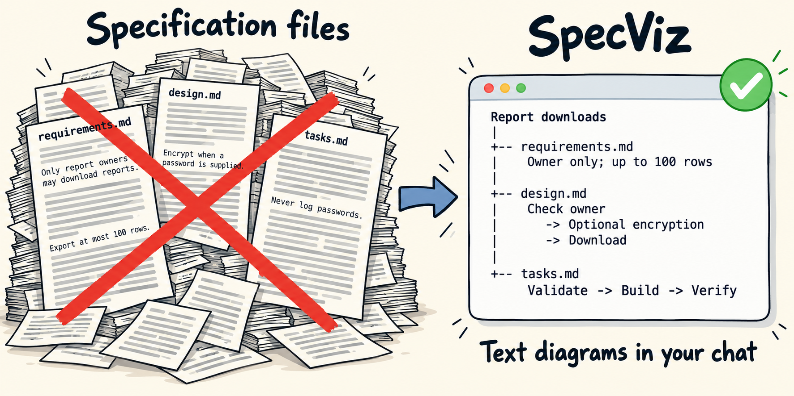

# SpecViz

**See the plan before reading every specification.**



SpecViz turns your specs into **flowcharts inside your coding chat**.
Follow the behavior, understand the conditions, then choose a file to explore.
Works with **Codex · Claude Code · Antigravity**.

[Get started](#quick-start) · [Commands](#three-commands-one-workflow) ·
[Eight-file example](examples/diagram-first/README.md) · [Compatibility](docs/compatibility.md)

## Three files. One visible workflow.

An agent spread a report-download feature across `requirements.md`, `design.md`,
and `tasks.md`. Ask `/specviz overview` (Codex: `$specviz overview`):

<!-- example: examples/kiro/overview.txt -->
```text
Reporting service - Export reports with owner access controls and clear download
limits.

Specification map (3 files)

                     +------------------------------------+
                     | Check report ownership             |
                     |                                    |
                     | Reject requests from anyone except |
                     | the report owner.                  |
                     | Files: [1] [3]                     |
                     +------------------------------------+
                                        |
                                        |
                                 owner accepted
                                        |
                                        v
                     +------------------------------------+
                     | Collect report rows                |
                     |                                    |
                     | Export at most 100 rows.           |
                     | Files: [1] [2]                     |
                     +------------------------------------+
                                        |
                   +--------------------+--------------------+
          password supplied                            no password
                   |                                         |
                   v                                         v
+------------------------------------+    +------------------------------------+
| Protect the download               |    | Continue without protection        |
|                                    |    |                                    |
| Encrypt the file when its owner    |    | Password protection is optional.   |
| supplies a password. Never log the |    | Files: [1]                         |
| password.                          |    |                                    |
| Files: [2]                         |    |                                    |
+------------------------------------+    +------------------------------------+
                   |                                         |
                   |                                         |
            encrypted file                           unprotected file
                   +--------------------+--------------------+
                                        v
                     +------------------------------------+
                     | Download the report                |
                     |                                    |
                     | Files: [2]                         |
                     +------------------------------------+

Files (3 files) under .kiro/specs/data-export/:
[1] design.md
[2] requirements.md
[3] tasks.md

Use show <file number or path> to explore a file; add --detailed to expand it.
```

This is actual output from the [Kiro example](examples/kiro/README.md).
The arrows show what happens. File keys show where the rules live.
No diagram viewer, browser, or downloaded image is needed.

<details>
<summary>Compare with the specification text</summary>

Shortened source excerpts from `.kiro/specs/data-export/`:

```text
requirements.md
  When an owner requests a report, export at most 100 rows.
  If a password is supplied, encrypt the file. Never log the password.
design.md
  Check ownership, collect report rows, optionally encrypt the download.
  Reject requests from anyone except the owner. Keep the 100-row limit.
tasks.md
  [ ] Validate report ownership.
  [ ] Add bounded export generation.
  [ ] Verify optional encryption and password handling.
```

</details>

## Quick start

Requires **Python 3.11+** and your existing coding agent. In a terminal:

```sh
git clone --branch main https://github.com/bao96-bioinfo/SpecViz.git
cd SpecViz
python3 tools/install.py --host all --project /path/to/your-project
```

Replace `/path/to/your-project` with the existing project containing your
specifications. For just one agent, replace `all` with `codex`, `claude-code`,
or `antigravity`. On Windows, use `python` if that is your Python 3.11+ command.

Open that project in a new coding conversation and enter:

| Coding agent | First command |
| --- | --- |
| Codex | `$specviz overview` |
| Claude Code | `/specviz overview` |
| Antigravity | `/specviz overview` |

Then pick a file by its displayed number, name, or path. SpecViz waits for
your choice before opening a file view.

The skill uses your existing agent and Python's standard library. Diagrams
appear as ordinary chat text, including when your agent runs on a server.
[Installation, updates, and removal →](docs/installation.md)

## Returning from the retired beta

Adaptive beta has been retired. Stable uses an 80-column default and draws
compact maps before long explanations. From the current `main` checkout:

```sh
python3 tools/install.py --channel stable --host all --project /path/to/your-project
```

This replaces owned beta files and removes that project's display callbacks.
Custom edits, other projects' registrations, and implementation evidence are
preserved. [Migration details →](docs/installation.md#return-from-retired-beta)

## Three commands, one workflow

Examples use `/specviz`; in Codex, use `$specviz` with the same arguments.

| Command | Use it to… |
| --- | --- |
| `/specviz overview` | Get the entire project's specification map. |
| `/specviz show design.md tasks.md` | Explain the files you choose. |
| `/specviz changes` | Compare the current specs with reported implementation. |

Focus on a feature with `/specviz overview openspec/changes/password-export`.
Use full paths when filenames repeat, and quote paths containing spaces.
[All commands and options →](docs/commands.md)

## Large project? See the connections first.

A complex overview starts with a compact map, then expands its nodes. This
synthetic example has **ten current files, seven components, and eight arrows**.
Eight archived files are excluded from the ordinary view.

<!-- example: examples/large-project/structure.txt -->
```text
 +-------------------------------+
 |                               |
 |              +--------+       |                              +--------+
 |              | Node 3 |       |                              | Node 6 |
 |              +--------+       |                              +--------+
 |                   |           |                                   |
 |                   v           v                                   v
+--------+      +--------+      +--------+      +--------+      +--------+
| Node 1 |----->| Node 2 |----->| Node 4 |----->| Node 5 |----->| Node 7 |
+--------+      +--------+      +--------+      +--------+      +--------+
                 |                                               ^
                 +-----------------------------------------------+
```

Node 1 prepares data; Node 2 trains the model; Node 3 speeds up training;
Node 4 produces predictions; Node 5 evaluates them; Node 6 prepares independent
reference values; Node 7 assembles the proposed notebook. The expanded boxes explain the
conditions and source files.
[Read the actual first page →](examples/large-project/overview-page-1.txt)

Use `/specviz show 2` after its file key appears, or select a full path.
`--detailed` expands the same structure with complete notes and open questions.
Continue a long view to reveal remaining maps, explanations, and file keys.
[Large-project example →](examples/large-project/README.md)

## See what still needs implementation evidence

`/specviz changes` compares current specifications with workflow completion and
verification reports. Changed files and their groups are marked in the map;
each behavior gets its own evidence box. Here is one actual box from the
[report-based example](examples/comparison/reports.txt):

<!-- example excerpt: examples/comparison/reports.txt -->
```text
File [2]: design.md

+------------------------------------------------------------------------------+
| [changed] Export design                                                      |
|                                                                              |
| Difference: behavioral                                                       |
| Evidence status: Earlier behavior reported implemented                       |
| Password protection adds a requested obligation to earlier file creation     |
| Earlier behavior verification: Unavailable; passing checks are not           |
| established.                                                                 |
+------------------------------------------------------------------------------+
```

The previous report covers file creation. Password protection is a newer
request. Displaying another diagram never clears that difference, and missing
evidence means **unknown implementation**.

Use `/specviz changes --check-code` to request a separate inspection of relevant
code and existing test definitions. It does not execute tests or change code.
Ordinary overview and file views only explain the specifications.

Reports need an explicit SpecViz handoff; native framework reports are not
imported automatically. [Connect a workflow](docs/installation.md#workflow-handoffs)
· [Understand the evidence](docs/comparison.md)

## Bring your existing specs

Keep your specification workflow and use SpecViz to explore what it produces:

| Framework | What SpecViz reads | Example |
| --- | --- | --- |
| OpenSpec | Main specs, proposals, designs, and tasks | [Explore](examples/openspec/README.md) |
| GitHub Spec Kit | Feature specs, plans, tasks, and project principles | [Explore](examples/spec-kit/README.md) |
| BMAD Method | Briefs, specifications, tickets, and story plans | [Explore](examples/bmad/README.md) |
| Superpowers | Designs and implementation plans | [Explore](examples/superpowers/README.md) |
| Kiro Specs | Requirements, bugfix specs, designs, and tasks | [Explore](examples/kiro/README.md) |

You can also select other Markdown files for generic views. Framework readers
and agent integrations are separate, making room for more of both.

Installation checks cover all three agents. Live conversation results are
versioned separately; see the [acceptance record](docs/acceptance.md).
[Supported layouts and limits →](docs/compatibility.md)

## Explore further

- [Text examples](examples/README.md): full overview and file views at both depths.
- [View guide](docs/views.md): layouts, source references, and large specifications.
- [Contributing](CONTRIBUTING.md): project structure, development, and tests.
- [Marketplace publishing](docs/publishing.md): the path to plugin distribution.

**Available now:** install the skill from this repository. Marketplace
packages and listings are still to come.

To run the test suite from the repository root:

```sh
python3 -m unittest discover -s tests -v
```

Contributions to framework support and clearer diagrams are welcome.
Licensed under [Apache 2.0](LICENSE).
